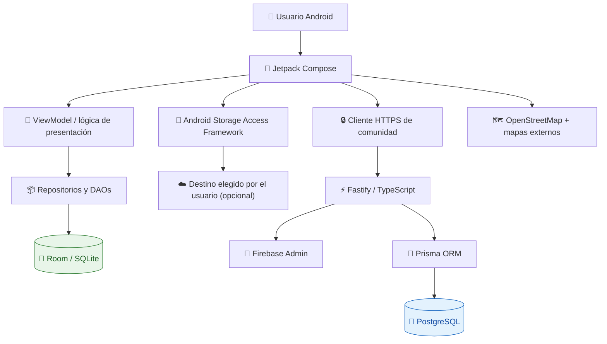
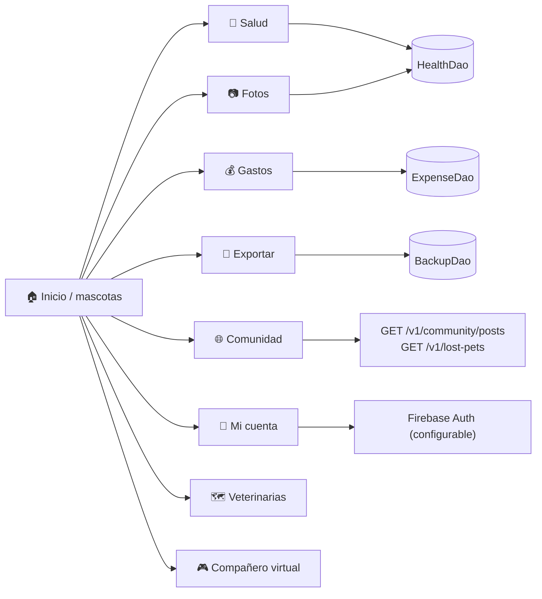
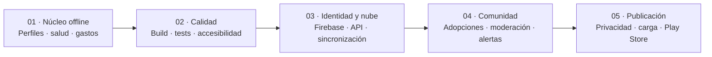

<div align="center">

# 🐾 Mi Mascota
### Tu ecosistema digital para el bienestar animal

**Android · Offline-first · Comunidad · Salud · Recuerdos**

[](android/)
[](backend/)
[](backend/prisma/)
[](#licencia-y-colaboraciones)
[](#estado-real-del-proyecto)

[Visión](#-visión) · [Funcionalidades](#-funcionalidades) · [Arquitectura](#-arquitectura) · [Instalación](#-puesta-en-marcha) · [Roadmap](#-hoja-de-ruta) · [Seguridad](#-seguridad-y-privacidad)

</div>

---

## 🌎 Visión

**Mi Mascota** es una plataforma de cuidado animal diseñada para unir el historial cotidiano de cada mascota con herramientas de salud, organización familiar y colaboración comunitaria. Su enfoque **offline-first** permite utilizar funciones locales incluso sin internet; las funciones comunitarias requieren un servidor configurado.

> **Principio de producto:** la información de tu mascota debe ser útil, accesible y estar bajo tu control.

<table>
<tr><td align="center">🐶<br/><b>Identidad</b><br/>Perfiles de mascotas</td><td align="center">💉<br/><b>Salud</b><br/>Vacunas y recordatorios</td><td align="center">📷<br/><b>Recuerdos</b><br/>Álbum local</td></tr>
<tr><td align="center">💰<br/><b>Control</b><br/>Gastos en soles</td><td align="center">🌐<br/><b>Comunidad</b><br/>Publicaciones y alertas</td><td align="center">🎮<br/><b>Experiencia</b><br/>Compañero virtual</td></tr>
</table>

## 🧩 Funcionalidades

| Módulo | Implementado en el código | Límite actual |
|:--|:--|:--|
| 🐾 Mascotas | Alta, selección, ficha detallada, edición y eliminación confirmada | Falta QA real y fotografías por defecto |
| 💉 Vacunas | Próxima dosis, historial y formulario de fechas | No hay agenda veterinaria externa |
| 📅 Recordatorios | Estado pendiente/completado y avisos locales con WorkManager | Los avisos no son exactos; push FCM pendiente |
| 💰 Gastos | Movimientos y totales en soles | Sin reportes analíticos exportables |
| 📷 Álbum | Miniaturas, visor y eliminación de referencias | No existe almacenamiento remoto automático |
| 💾 Respaldo | Exportación y restauración JSON v1–v3; ZIP con archivos fotográficos | ZIP/JSON aún sin cifrado; fotos inaccesibles se omiten |
| 🏡 Adopciones | Publicaciones, solicitudes, estados y cierre en Android/API | Requiere Firebase, servidor y moderación configurados |
| 📢 Perdidos | Avisos de mascotas, estado, cierre y revisión | Fotografías remotas, geolocalización de alertas y push pendientes |
| 🌐 Comunidad | Lectura y creación de publicaciones con moderación previa | Sin comentarios ni chat |
| 🛡️ Moderación | Cola de revisión y aprobación/rechazo, autorizada por UID | Requiere configurar `MODERATOR_UIDS` |
| 🔐 Cuenta | Google/Firebase Sign-In opcional desde la app | Requiere proyecto Firebase real y OAuth |
| 🗺️ Veterinarias | Mapa integrado OpenStreetMap, permiso aproximado opcional y apertura de mapas externos | Sin directorio veterinario verificado |
| 🎮 Juegos | Compañero virtual persistente y minijuego de huellas | Animaciones y minijuegos avanzados pendientes |
| 📲 APK | Compilación debug y artifact descargable en GitHub Actions | No es APK firmado de producción |

**Estado de calidad:** código integrado en el repositorio, sujeto a compilación y pruebas en GitHub Actions y dispositivos. No se considera publicado en Google Play.

## 🏗️ Arquitectura



**Separación de responsabilidades**

| Capa | Tecnología | Responsabilidad |
|---|---|---|
| Presentación | Kotlin + Jetpack Compose | Pantallas, navegación y estados |
| Datos locales | Room + Kotlin Flow | Persistencia y lectura reactiva |
| Servicios Android | SAF, Credential Manager | Documentos y autenticación |
| API | Fastify + TypeScript + Zod | Validación y rutas HTTP |
| Autorización | Firebase Admin | Verificación de tokens en rutas protegidas |
| Persistencia remota | Prisma + PostgreSQL | Datos comunitarios y perfiles remotos |
| Calidad | GitHub Actions | Validación Prisma y compilaciones automatizadas configuradas |

### 🔌 Mapa de navegación y cableado



## 🗂️ Organización del repositorio

```text
Mi-mascota/
├── android/
│   ├── app/
│   │   ├── build.gradle.kts
│   │   └── src/main/
│   │       ├── AndroidManifest.xml
│   │       └── java/pe/mimascota/app/
│   │           ├── auth/       # Acceso Google
│   │           ├── backup/     # Exportación JSON
│   │           ├── data/       # Room, entidades y DAOs
│   │           ├── domain/     # Cálculos y reglas
│   │           └── ui/         # Pantallas Compose
│   └── settings.gradle.kts
├── backend/
│   ├── prisma/
│   │   ├── schema.prisma
│   │   └── migrations/
│   └── src/
│       ├── routes/
│       ├── auth.ts
│       └── server.ts
├── docs/                    # Arquitectura, seguridad, QA y auditorías
└── .github/workflows/       # CI
```

## 🚀 Puesta en marcha

### Requisitos

- **Android:** Android Studio compatible con AGP 8.7.3, JDK 17, SDK Android 35; Gradle 8.10.2.
- **Backend:** Node.js 22, npm y una instancia PostgreSQL.
- **Opcional para Google:** proyecto Firebase y cliente OAuth web configurados.

### 1. Obtener el código

```bash
git clone https://github.com/cponce123com-create/Mi-mascota.git
cd Mi-mascota
```

### 2. Iniciar el backend

```bash
cd backend
npm install
cp .env.example .env
# Edita .env con tu DATABASE_URL real y configura Firebase Admin si usarás rutas protegidas.
npx prisma validate
npm run prisma:generate
npm run prisma:migrate
npm run build
npm test
npm start
```

El endpoint de comprobación es **`GET /health`**. Las rutas protegidas requieren un token válido de Firebase. **No subas `.env` ni credenciales al repositorio.**

### 3. Abrir Android

Abre la carpeta **`android/`** en Android Studio y sincroniza Gradle. Para compilar desde terminal con Gradle instalado:

```bash
cd android
gradle :app:assembleDebug :app:testDebugUnitTest --no-daemon
```

La aplicación puede iniciar en modo local sin backend. Para conectar comunidad y acceso Google, configura las propiedades de Gradle mediante `~/.gradle/gradle.properties` o tu sistema de CI:

```properties
API_BASE_URL=https://tu-api.example.com
GOOGLE_WEB_CLIENT_ID=tu-cliente-oauth-web.apps.googleusercontent.com
```

El acceso con Google también requiere que Firebase esté correctamente inicializado para la aplicación Android. **Estas propiedades no reemplazan la configuración de Firebase ni autorizan por sí solas el acceso a la API.**

### 4. Pruebas

```bash
# Desde backend/
npm run build

# Desde android/
gradle :app:testDebugUnitTest :app:assembleDebug --no-daemon
```

GitHub Actions valida Prisma, aplica migraciones en un PostgreSQL temporal, ejecuta pruebas del backend y compila/prueba Android. Si el job **android** termina correctamente, publica `Mi-Mascota-Android-Debug` como artifact ZIP con `app-debug.apk`.

[📥 Descargar APK desde Actions](https://github.com/cponce123com-create/Mi-mascota/actions) (abre el último flujo verde y despliega **Artifacts**). No se garantiza aquí que la ejecución más reciente haya terminado correctamente.

## 🗺️ Hoja de ruta



**Próximos hitos prioritarios:** corregir cualquier fallo de CI, ejecutar pruebas de migraciones Room y Prisma, completar restauración de respaldos, proteger publicaciones comunitarias con moderación y verificar el rendimiento en dispositivos reales.

Consulta también [ROADMAP](docs/ROADMAP.md), [QA](docs/QA_CHECKLIST.md) y [auditoría integral](docs/AUDITORIA_INTEGRAL_2026-11-08.md).

## 🛡️ Seguridad y privacidad

- **Offline-first:** los registros locales permanecen en Room; no se sincronizan automáticamente por iniciar sesión.
- **Fotos:** actualmente se guardan referencias URI, no copias de las imágenes.
- **Exportación:** los archivos JSON y ZIP contienen datos potencialmente sensibles y **no están cifrados**; el ZIP puede incluir imágenes, y debe guardarse en un lugar privado.
- **Comunidad:** las lecturas públicas filtran contenido aprobado. Las escrituras requieren Firebase y se publican inicialmente como pendientes de moderación.
- **Producción:** faltan controles adicionales de moderación, protección contra abuso distribuido, privacidad y pruebas de seguridad.

Más información en [docs/SECURITY.md](docs/SECURITY.md).

## 🤝 Colaboraciones

Se aceptan propuestas de mejoras, informes de errores y pruebas reproducibles mediante **Issues** y **Pull Requests**. Antes de incorporar funcionalidades de repositorios externos se deben verificar licencia, atribución, dependencias y compatibilidad técnica.

## 📄 Licencia y colaboraciones

**Aún no se ha definido ni publicado una licencia de software para este repositorio.** Ser público en GitHub no equivale a conceder permisos de reutilización. Antes de redistribuir o incorporar código de terceros, solicita autorización y verifica las condiciones legales aplicables.

---

<div align="center">

### 🐾 Mi Mascota
**Tecnología que acompaña, cuida y conecta.**

<sub>Proyecto en desarrollo · Android + servicios opcionales en la nube · Documentación sujeta a cambios</sub>

</div>
